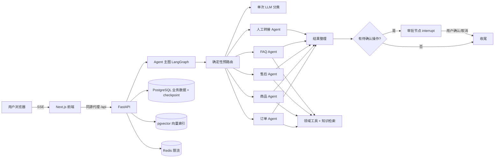

# Nova 电商智能客服 · 架构设计

本文档记录系统的架构、关键设计决策与取舍，作为 README 的补充。

## 1. 目标与范围

面向电商客服场景，提供一条从用户提问到业务动作闭环的链路：

- 查订单、物流、售后进度
- 商品检索、详情、对比、缺货订阅
- 退换货、取消订单、修改收货地址等**变更操作**
- FAQ 与知识库问答
- 人工转接、满意度反馈、会话记忆

设计约束：

- 变更类操作必须用户确认后才落库，不允许模型直接写业务数据
- 模型只能使用工具返回的事实，不允许编造订单号、金额、物流状态
- 同一会话内的生成与审批必须串行，避免并发写同一个 checkpoint
- 关键路径可降级：Redis 不可用、向量索引不可用、LLM 不可用时都有兜底

## 2. 总体架构



分层：

| 层 | 职责 |
|---|---|
| `api/routers` | HTTP/SSE 入口、鉴权依赖、参数校验、错误映射 |
| `services` | 对话编排、审批执行、记忆压缩、认证 |
| `agents` | 路由、子 Agent、工具、护栏、结果整理 |
| `db/repositories` | 所有 SQL 的唯一入口 |
| `core` | 配置、日志、限流、指标、安全、可观测性 |

## 3. 技术选型

| 选择 | 理由 |
|---|---|
| FastAPI | 原生 async、SSE 流式简单、Pydantic 契约清晰 |
| LangGraph | 需要持久化 checkpoint + 中断恢复，普通链式调用无法可靠实现“确认后继续” |
| PostgreSQL | 业务数据、审计、checkpoint 同一套库，减少运维面 |
| pgvector + HNSW | 向量检索从全表余弦降到索引查询，压测吞吐提升约 17 倍 |
| Redis | 多实例下限流/登录锁定计数一致；不可用时降级为进程内 |
| Next.js App Router | 同源代理保留 SSE，前端可用 Server Component 拉取静态数据 |
| structlog + LangSmith | 结构化日志便于检索，LangSmith 用于 Agent 链路回放 |

## 4. 一次对话的完整链路

1. 前端 `POST /api/chat/{id}/stream`，携带 `client_message_id`。
2. 后端校验会话归属、待确认操作、会话锁、用户并发槽位、限流。
3. 落库用户消息（`client_message_id` 幂等），必要时用首句生成会话标题。
4. 读取会话摘要与用户画像，拼成 `context_block`。
5. LangGraph 执行：
   - `pre_route` 正则命中直接进域 Agent；未命中才走 `classify`（一次 LLM 分类）
   - 域 Agent 走 ReAct 循环，工具结果以 `content + artifact` 返回
   - `postprocess` 抽取结构化卡片、去重、检测未确认的成功声明
   - 有 `pending_action` 时进入 `approval` 节点并 `interrupt`
   - 否则 `finalize`
6. SSE 按事件推送：`meta → status → token → (reset) → approval → done`
7. 落库助手消息与结构化 parts，异步刷新会话记忆。

SSE 事件约定：

```
event: meta       {"conversation_id","title","run_id"}
event: status     {"stage","label"}
event: token      {"text"}
event: reset      {"reason"}          # 工具调用前撤回旁白
event: approval   {"action","action_id","summary","title"}
event: done       {"message_id","content","parts","degraded"}
event: error      {"code","message","degraded","retryable"}
```

超过 15 秒无输出时服务端发送 `: ping` 注释行，避免反向代理按空闲超时断开。
网络中断后前端会重新拉取最近一页消息：若服务端已落库则直接恢复回答，
否则保留 `client_message_id` 供用户重试，避免重复用户消息。

## 5. Agent 设计

### 5.1 确定性路由优先

规则命中直接进域 Agent，零 LLM 开销；只有未命中才调用一次结构化分类。
分类失败或熔断时回退 `faq`，保证链路不断。

### 5.2 工具护栏

- 单轮工具调用次数上限（默认 8）
- 单次工具超时（默认 30 秒）
- 超限/超时/异常都转成 `error` artifact，而不是抛出异常打断 ReAct 循环
- 预算通过 `ContextVar` 按请求隔离，不依赖全局状态

### 5.3 回答校验

- 工具调用前模型输出的“正在查询…”旁白会被 `reset` 撤回，避免用户看到内部过程
- 未确认就宣称“已提交/已修改”的回答会被替换为提示语；正则要求第一人称或“已为您”，
  避免误伤“退款已提交至支付渠道”这类流程描述
- 空结果兜底为可读的错误话术

### 5.4 变更与对比的确定性前置

对“取消订单 + 明确订单号”的请求，在进入 Order Agent 前先确定性执行 `cancel_order`，
把真实的 tool_call 与 `pending_action` 注入消息历史，再由模型组织回答。
这样即使模型偶尔只解释不调工具，也不会出现“口头已生成、实际没有待确认操作”的情况；
订单状态不允许取消时则不注入，交给 Agent 正常解释。

对比类问题同理：先按“和/与/vs”拆出商品名，逐个搜索解析 ID，再确定性调用
`compare_products` 注入对比结果，避免模型只搜索结果、不走对比工具。

## 6. 审批与一致性

变更操作的分层保障：

| 层 | 机制 |
|---|---|
| 工具层 | 只产出 `pending_action`，不写业务库 |
| 记录层 | `idempotency_key` 唯一索引，重复调用不产生多条记录 |
| 执行层 | `UPDATE ... WHERE status='pending'` 原子 claim，保证只执行一次 |
| 状态机 | `pending → executing → approved / failed / rejected / expired` |
| 二次校验 | 执行前再次校验操作对象归属当前用户，防越权 |
| 会话层 | 同一会话的生成与审批串行锁 |
| 清理层 | 过期审批清理时同时删除对应 checkpoint thread，避免 interrupt 卡死会话 |

并发集成测试用 `asyncio.gather` 同时提交两次审批，断言只创建一条售后申请。

## 7. 数据模型

| 表 | 用途 |
|---|---|
| `users` / `auth_sessions` | 用户、可撤销会话令牌 |
| `products` / `orders` / `order_items` | 商品与订单 |
| `return_requests` / `restock_subscriptions` | 售后、缺货订阅 |
| `conversations` / `messages` | 会话与消息，消息带结构化 `parts` |
| `conversation_summaries` / `user_profiles` | 记忆摘要与画像 |
| `pending_actions` / `audit_events` | 待确认操作与审计 |
| `faqs` / `rag_documents` / `rag_chunks` | FAQ 与知识库切片 |
| `retrieval_logs` | 检索命中日志 |
| `answer_feedbacks` | 回答满意度 |
| LangGraph checkpoint 表 | 会话中断与恢复 |

Schema 只由 Alembic 管理，禁止运行时 `create_all`。

## 8. RAG 设计

### 8.1 索引

- 文档按标题层级与段落切分，保留来源元数据
- 向量列 `embedding_vec vector(1024)`，HNSW 索引使用 `vector_cosine_ops`
- 扩展不可用时自动降级为 JSONB + numpy 余弦，功能不中断

### 8.2 双路召回 + 加权 RRF

```
score(doc) = Σ weight_route / (k + rank_route)
```

- 向量路与关键词路各取 12 条候选，`k=10`，权重向量:关键词 = 2:1
- 融合后截断 Top4，作为工具结果注入 Agent

### 8.3 评测结果

55 条人工标注问法（246 个切片）：

| 策略 | Recall@4 | MRR@4 |
|---|---:|---:|
| 向量单路 | 98.2% | 0.955 |
| 关键词单路 | 83.6% | 0.750 |
| 加权 RRF | 98.2% | 0.945 |

结论：当前语料下向量单路已很强，RRF 主要作为关键词降级与鲁棒性兜底；
当语料变为型号/专有名词密集型时应重新评测调权。这是刻意保留的“可解释的次优”。

检索压测（246 切片、并发 8、排除远程 embedding）：

| 实现 | QPS | P50 | P95 |
|---|---:|---:|---:|
| JSONB + numpy 全表余弦 | 7.5 | 902ms | 1038ms |
| pgvector + HNSW | 133.4 | 44ms | 62ms |

## 9. 记忆系统

- 会话摘要 + 用户画像，按 token 预算注入 `context_block`
- 每轮结束后异步刷新，5 分钟节流，避免频繁调用 LLM
- 后台任务持有引用并在停机时 drain，防止任务被提前回收或丢失

## 10. 安全与限流

- 手机号只存 SHA-256 哈希，展示脱敏，不进入 Prompt / 日志
- JWT 存 httpOnly Cookie，服务端保存令牌哈希，可撤销
- 所有会话/审批/反馈接口校验归属；管理员接口校验角色
- Redis Lua 原子滑动窗口限流；登录失败按手机号与 IP 双维度锁定
- 默认不信任 `X-Forwarded-For`，仅可信代理后开启
- 生产环境启动校验：默认密钥、非 TLS Cookie、默认数据库口令直接拒绝启动

## 11. 可观测性

- structlog JSON 日志，带 `request_id`，敏感字段脱敏
- `/api/metrics`（Prometheus）与 `/api/metrics/json`：对话、降级、取消、错误、限流
- `/api/health` 存活探针；`/api/health/ready` 就绪探针检查数据库、Redis 与 checkpointer，
  Redis 不可用时标记 degraded 但继续服务；Docker healthcheck 使用 ready 端点
- LangSmith 按配置开启，记录路由、工具调用、LLM 耗时与失败原因；
  `thread_id` 同时作为会话归组键，可按会话回放

## 12. 测试与评测

| 类型 | 内容 |
|---|---|
| 单元测试 | 路由、护栏、限流、检索、记忆、Schema、可观测性、审批执行 |
| 集成测试 | 审批并发、SSE 心跳与槽位释放、消息幂等、游标分页 |
| 静态检查 | ruff + mypy（64 个文件 0 错误） |
| 覆盖率 | 约 71%（199 个测试），检索、索引、清理、限流、审批、Agent 图与核心工具已覆盖；剩余缺口在工具边缘分支与前端组件 |
| 检索评测 | 55 条问法，Recall@4 / MRR@4 |
| 回答评测 | 25 条 golden QA × 3 轮，端到端 75/75（100%） |

CI 流程：PostgreSQL 服务 → Alembic 迁移 → ruff → mypy → pytest（含覆盖率门槛）→ 前端 typecheck → 前端单测。

## 13. 部署

```bash
docker compose up --build
```

API 容器入口脚本会自动执行 `alembic upgrade head` 与幂等 seed（已有数据时跳过），
首次启动即可使用；需要重置数据时再手动执行：

```bash
docker compose exec api python -m ecommerce_cs.seed_data --reset --with-index
```

镜像：`pgvector/pgvector:pg16`、`redis:7-alpine`、Python 3.12 slim、Node 22 alpine。

在线交互演示（预置对话回放，不连接后端）通过 GitHub Pages 发布：
<https://kskblccw.github.io/nova-ecommerce-cs/>

## 14. 已知取舍

- 会话锁是进程内锁，单实例可靠；多实例需替换为 Redis 分布式锁
- 依赖锁定到直接依赖，传递依赖仍由 pip 解析
- 前端自动化测试聚焦 SSE 解析等纯逻辑，组件交互以手工回归为主
- 评测语料为演示规模，指标用于验证方向，不代表线上流量
